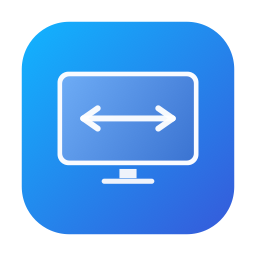
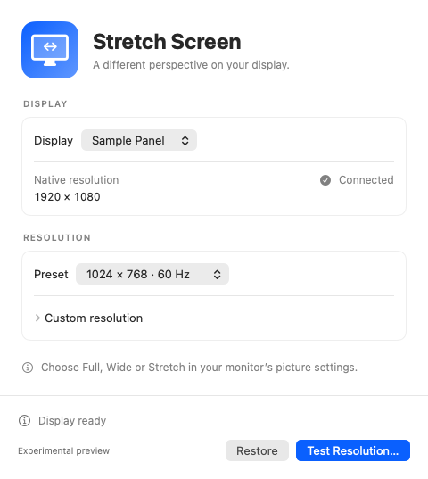
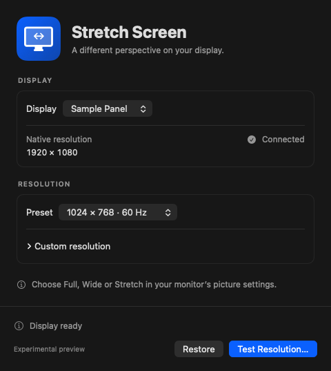

# Stretch Screen



A small Swift / SwiftUI macOS utility for testing a **physical 4:3 output signal** on an external monitor. The monitor's own **Full / Wide / Stretch** scaler fills the panel; this app does not create a virtual display, capture the screen, or stream the desktop.

> **Status: experimental preview, not a production-certified display driver.**
> The override uses Apple's private `IOAVServiceSetVirtualEDIDMode` API. It can interrupt video output, and a driver/system hang can prevent automatic recovery. Previous local development tests caused loss of video output. No cross-hardware live-test matrix has been completed. Do not describe this release as universally safe or production-ready.

## Native macOS interface

A compact SwiftUI utility with native controls, light and dark appearances, keyboard shortcuts,
custom resolution inputs, and an explicit timed confirmation before keeping a change.
The app is displayed as **Stretch Screen**; repository, bundle filename and command-line executable
remain `Mac-Streched-Screen`.

<p>
  
  
</p>

Screenshots use synthetic monitor data. No monitor identifiers are included.

## Requirements and limits

- Apple Silicon Mac, macOS 13 or newer; building requires Xcode / Swift 5.10+.
- A directly connected, uniquely identifiable, active external monitor, not mirrored.
- A valid EDID 1.3/1.4 with complete supported frequency and pixel-clock limits.
- A monitor with its own Full / Wide / Stretch aspect-ratio setting.
- Built-in panels, Intel Macs, DisplayLink, AirPlay, Sidecar and virtual displays are not targets.
- Extended EDID range offsets are not implemented; ambiguous or incomplete limits are refused.
- Integer refresh inputs only; the real CVT rate may be slightly lower.
- Removing EDID extensions temporarily removes extension-only features such as HDR and HDMI audio.

The implementation derives timing candidates from each monitor's own EDID. It contains **no vendor/product whitelist or device-specific timings**. Range compliance is necessary, **not proof of cable/scaler/driver compatibility**. Symbol availability is not a macOS support certification.

## Build and open

```sh
swift test
./Scripts/build-app.sh release
open dist/Mac-Streched-Screen.app
```

Open `Package.swift` in Xcode to develop. There are no external package dependencies.
The bundled app includes a separately signed `StretchRestoreHelper`; the bare SwiftPM GUI binary intentionally cannot test a mode without its bundled helper.

## Use

1. Save your work and set the monitor's picture format to Full, Wide or Stretch.
2. Open the app. Discovery and Refresh are read-only: **opening the app never changes a mode**.
3. Choose the external display and an EDID-compatible candidate. Start with a low-resolution 60 Hz candidate.
4. Choose **Test Resolution…**, then read and acknowledge the experimental API warning in the confirmation sheet.
5. The app validates the live monitor again, writes a create-only factory backup, and waits for the independent helper's readiness acknowledgement **before** applying anything.
6. Click **Keep Resolution** only if the new image is visible. Return/Enter intentionally cannot blindly keep a black screen. Without confirmation, the helper attempts recovery after 20 seconds.
7. **Restore** removes the temporary override. A reset does not promise the exact previous refresh rate, desktop arrangement or window placement.

The override is not a boot-time/system-file modification. No administrator access, SIP changes, kernel extension, persistent background agent or network access is used.

## Recovery

If the image goes black, allow the recovery deadline to pass. If the driver or OS is hung, a helper cannot repair that: disconnect/reconnect the monitor, or reboot as a last resort.

From another accessible screen or Terminal:

```sh
"dist/Mac-Streched-Screen.app/Contents/MacOS/Mac-Streched-Screen" list
"dist/Mac-Streched-Screen.app/Contents/MacOS/Mac-Streched-Screen" restore
```

Recovery targets this app's recognized overrides only, not arbitrary third-party display state. Failed/corrupt pending records are not silently discarded; see [recovery troubleshooting](docs/SAFETY.md).

## Safety architecture

- EDID inputs are bounded, checksummed and parsed without trusting descriptor lengths/ranges.
- Exact 4:3 and 8-pixel alignment are enforced; dimensions are not silently rounded.
- Missing/unsupported limits fail closed; candidates are not called “safe” or “recommended”.
- Factory bytes and SHA-256 sidecar are create-only, synced to disk, private to the current user, and verified before every mutation. Known override markers are never archived as factory data.
- The helper is a separate executable, not the calling process. It cannot apply a mode or recursively spawn helpers.
- Keep and helper rollback share a cross-process lock. A cancelled record cannot subsequently trigger a reset.
- Partial apply errors retain recovery state. Expired Keep, concurrent tests, changed capabilities, duplicate monitor identities and unplugged displays are refused.
- UI uses a serial worker actor for blocking IOKit/filesystem calls. No repeated idle EDID polling or backup rewrites.

See [architecture](docs/ARCHITECTURE.md), [safety and residual risks](docs/SAFETY.md), [verification](docs/VERIFICATION.md) and [release instructions](docs/RELEASING.md).

## Development checks

```sh
./Scripts/check.sh
swift run PreviewRenderer /tmp/mac-streched-previews
# Rebuild the code-drawn icon without external tools or services:
swift Scripts/make-icon.swift /tmp/StretchScreen.iconset
iconutil -c icns /tmp/StretchScreen.iconset -o Resources/AppIcon.icns
```

Automated tests use **synthetic EDIDs, fake display platforms and fake recovery guards**. They never change a live display or launch a hardware recovery helper. CI must not perform physical display mutations.

## Distribution

The build script produces an ad-hoc-signed local preview by default. Public downloaded binaries should be Developer ID signed and notarized; instructions are in [RELEASING.md](docs/RELEASING.md). Signing/notarization does not make a private API stable. Tagged versions are packaged by GitHub Actions as experimental, ad-hoc-signed previews with SHA-256 checksums. These previews are not notarized.

## License and contributions

MIT. See [LICENSE](LICENSE), [THIRD_PARTY_NOTICES.md](THIRD_PARTY_NOTICES.md), [CONTRIBUTING.md](CONTRIBUTING.md) and [SECURITY.md](SECURITY.md).
